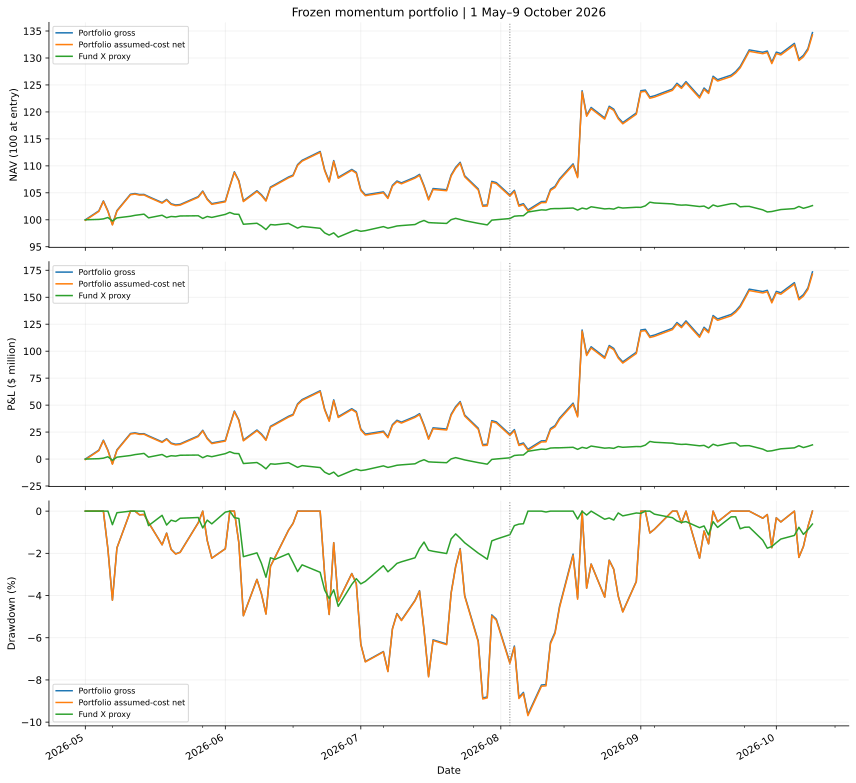
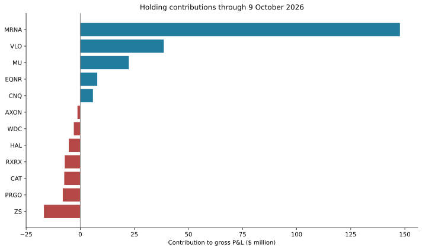
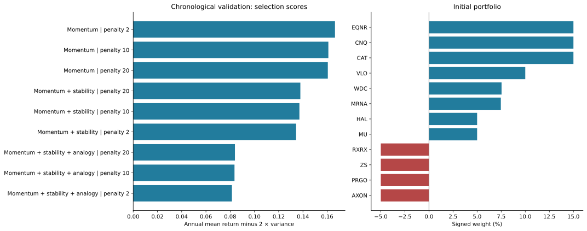
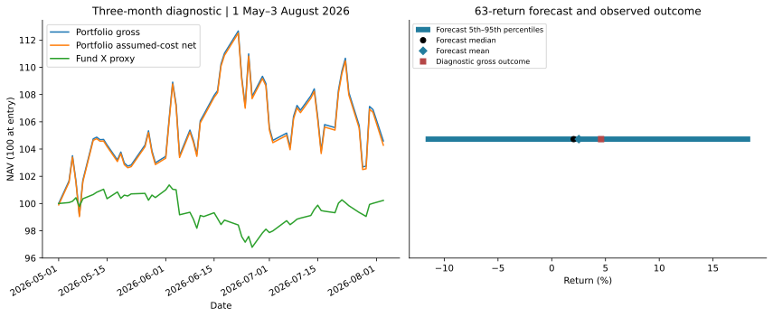
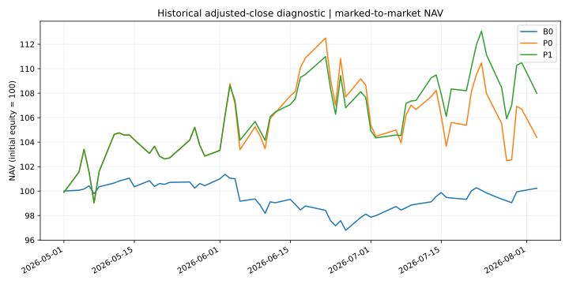
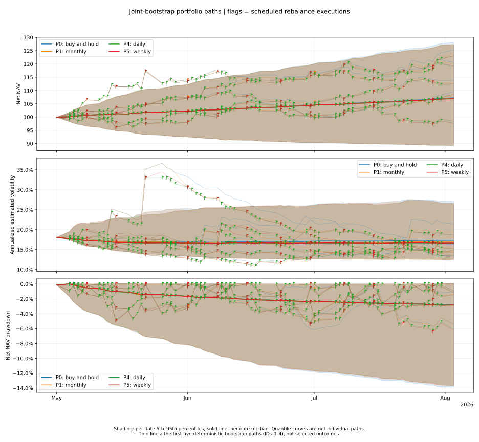
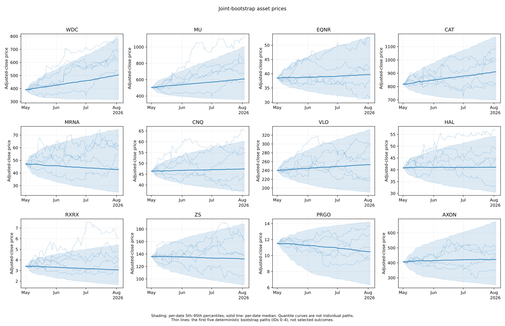
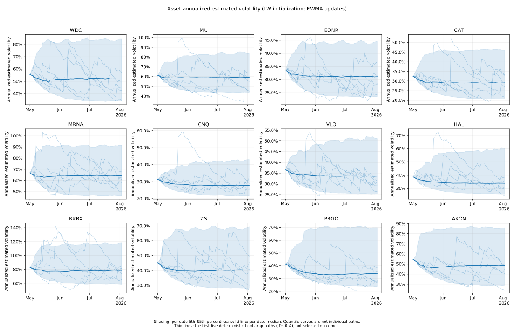

# GMC Momentum Portfolio Research

**本分支：原動量組合＋再平衡研究。** 請見下方 [再平衡機制與模擬圖表](#再平衡機制與模擬圖表)，包含每日、每週及每月規則、事件旗標、價格與風險路徑。前半部保留原始買入持有研究。

A stocks-only long/short portfolio built from chronological strategy validation, constrained optimisation, and Monte Carlo forecasts. This repository contains the selected **momentum strategy with risk penalty 2**, its executable analysis, frozen allocation, and supporting results.

**Recorded diagnostic return, 1 May–9 October 2026: +34.71% gross and +34.29% after illustrative costs**, compared with **+2.63%** for the Fund X proxy. Starting equity is $500 million. These are modelled returns from saved adjusted-price data. The evaluation period had already been explored during research, and the input data's provenance and corporate-action adjustments have not been independently verified.



## Recorded results

| Period | Portfolio gross | After assumed costs | Fund X proxy | Gross P&L |
|---|---:|---:|---:|---:|
| 1 May–3 August 2026 · 63 return intervals | +4.59% | +4.28% | +0.23% | +$22.95m |
| 1 May–9 October 2026 · 111 return intervals | +34.71% | +34.29% | +2.63% | +$173.56m |

The extended period has **34.32% annualised gross volatility** and **−9.63% maximum gross drawdown**. The original three-month Monte Carlo forecast has a gross mean return of **+2.52%** and a 5th–95th percentile range of **−11.74% to +18.47%**. The October evaluation extends beyond that forecast horizon.



**Profit concentration matters:** MRNA contributes $147.73m, approximately 85% of the total gross P&L. Its saved adjusted-price return is +395.92% over the extended period. That observation warrants independent data verification before drawing conclusions about repeatability.

## Scope and portfolio rules

The candidate universe is a fixed allowlist of **123 operating-company stock tickers** represented in the supplied historical data. It spans technology, healthcare, finance, industrials, and energy, including US companies and internationally headquartered issuers represented by their supplied tickers. The scope is bounded by this allowlist and the available price history. The full list appears as `stock_allowlist` in [analysis.py](analysis.py), and its price series are included in [data/](data/).

For the final two-year estimation window, **119 stocks pass the eligibility screen**. Candidates require at least 98% daily-return coverage, positive prices, and a maximum absolute daily return of 40% within the window. BE, DXCM, and RUN fail these filters; FOLD is excluded because its acquisition completed before entry. Both long and short candidates come from the eligible stock universe. The selected portfolio holds eight longs and four shorts. ETFs, bonds, commodities, currencies, and derivatives are outside the portfolio's current investment universe. The Fund X comparison uses separate benchmark instruments.

This is a **buy-and-hold strategy**: the portfolio enters once on 1 May 2026 and holds the initial share quantities through each evaluation endpoint. Position weights drift as prices change. Each selected stock's **initial net position has an absolute size of at least 5% and at most 15% of starting equity**: longs carry positive weights and shorts carry negative weights. The minimum applies at entry; subsequent price changes can move weights outside that range. The total initial portfolio net exposure is 60%, with 80% long exposure and 20% short exposure.

**Transaction costs (TC)** are assumed to be **10 basis points (0.10%) of traded notional at entry and at each evaluation's hypothetical exit**. Exit costs use the ending position values. Short borrowing costs are **2% per year on the initial short notional**, accrued using elapsed daily-return intervals divided by 252. The after-cost figures include these charges. Cash earns zero interest; taxes, additional financing charges, and a separate market-impact or slippage model are outside the accounting scope.

## Strategy

At every historical allocation date, the model uses the preceding two years of prices. Nine rule/penalty combinations are compared over 13 chronological blocks of 63 daily returns. Momentum with risk penalty 2 has the highest validation selection score; its recorded cumulative validation return after assumed costs is +105.15% across 819 daily returns.

The momentum score combines twelve-month momentum excluding the latest 21 sessions (35%), six-month momentum excluding the latest 21 sessions (30%), recent three-month momentum (15%), and six-month momentum relative to sector peers (20%). Cross-sectional ranks temper extreme observations. Ledoit–Wolf covariance and constrained optimisation translate the scores into weights.

| Initial constraint | Setting |
|---|---|
| Instruments | Operating-company stocks |
| Gross exposure / starting equity | $500m / $500m |
| Long / short exposure | 80% / 20% |
| Holdings | 8 long, 4 short |
| Absolute position size | 5%–15% |
| Sector gross exposure cap | 45% |
| Final estimation window | 29 April 2024–28 April 2026 |
| Portfolio accounting | Fixed initial units; zero-interest cash |
| Illustrative costs | 10 bps at entry and exit; 2% annual borrow on initial shorts |

Risk enters through the variance penalty and exposure limits. The selected strategy has no hard volatility ceiling. Holdings drift with prices after entry. Fund X is a daily-rebalanced public proxy: 20% `^SPGSCI`, 50% `URTH`, and 30% `BNDW`. Portfolio holdings remain stocks-only.



## Reproduce

Use Python 3.11 or newer, from this repository's root:

```bash
python -m venv .venv
```

Activate the environment on Windows PowerShell:

```powershell
.\.venv\Scripts\Activate.ps1
```

On macOS or Linux:

```bash
source .venv/bin/activate
```

Install dependencies and verify the published results without network access:

```bash
python -m pip install -r requirements.txt
python report.py
```

`report.py` independently rebuilds both evaluation paths from saved prices and checks the frozen-weight SHA-256, exposure constraints, selected validation winner, training cutoff, returns, illustrative costs, benchmark, volatility, drawdown, and holding attribution. It also regenerates all four SVG figures.

To rerun historical model selection, portfolio construction, the 10,000-path forecast, and both evaluations:

```bash
python analysis.py
```

The runner writes results into `aligned_method/validated_strategy/`. Saved evaluation price caches make the recorded date ranges reproducible offline. If those caches are removed, the runner attempts to download prices with `yfinance`; availability and vendor revisions may affect the result. Dependency ranges allow compatible installations; numerical optimiser outputs can vary slightly across versions. The published weight hash identifies the recorded allocation.

The [executed notebook](GMC_Validated_Strategy.ipynb) presents the same analysis with its recorded tables (figures render when rerun). Open it with `jupyter lab`. Run it from the repository root, and restart the kernel before executing all cells.



## Repository contents

| File | Purpose |
|---|---|
| [analysis.py](analysis.py) | Full strategy selection, optimisation, forecasts, and evaluation |
| [report.py](report.py) | Offline accounting verification and README charts |
| [GMC_Validated_Strategy.ipynb](GMC_Validated_Strategy.ipynb) | Selected strategy's executed research notebook |
| [METHODOLOGY.md](METHODOLOGY.md) | Detailed method, portfolio table, assumptions, and interpretation |
| [data/](data/) | Monthly stock-universe training CSVs from January 2021 through the information cutoff |
| [aligned_method/validated_strategy/](aligned_method/validated_strategy/) | Frozen strategy and weights, cached evaluation prices, CSV tables, and figures |

The monthly training CSVs preserve the source values for the operating-company allowlist and the dates needed by this strategy. Earlier unused history and instruments outside the strategy's universe are omitted.

## 再平衡機制與模擬圖表

本 `with-rebalancing` 分支在原動量組合上加入每月、每日及每五個交易日再平衡。保留原本 12 隻股票、多空方向及相對目標權重，每次調整持倉數量以恢復凍結目標。原始買入持有研究保留在 `aligned_method/validated_strategy/`。

### 何時再平衡？

| 策略 | 規則 | 狀態 |
|---|---|---|
| P0 買入持有 | 建倉後固定數量，權重隨價格變動 | 已執行，曲線無旗標 |
| P1 每月 | 每月第一個交易日；本期為 6 月 1 日、7 月 1 日 | 已執行 |
| P4 每日 | 每日前收市後計算，下一交易日執行 | 已執行 |
| P5 每五個交易日 | 觀察值 1–5 完成後，於觀察日 6 執行，之後每五日一次 | 已執行 |
| P2／P3 初始風險縮放 | 預先縮放曝險，搭配買入持有／每月再平衡 | 待設定有依據的風險預算 |
| P6 風險觸發 | 前一日估計波動率超標時降低曝險 | 引擎已實作，正式門檻未設定 |
| P7 虧損觸發 | 前一日回撤超標時一次性減倉 | 引擎已實作，門檻與比例未設定 |

### 前一日決定，下一日固定數量成交

1. 第 t−1 日收市後，讀取已完成的價格、持股、現金與淨資產值（NAV）。
2. 計算目標數量：`原目標權重 × 前日 NAV ÷ 前日價格`，扣除現有持倉後，將交易數量四捨五入至整個合成單位。
3. 第 t 日按固定數量成交，扣除費用，記錄成交後權重偏差。
4. 第 t 日資料完成後更新風險，供下一日決策使用。每條模擬路徑各自維護價格、持倉、現金及風險。

建倉日為 2026 年 5 月 1 日，終點為 8 月 3 日，共 64 個收市觀察值及 63 段報酬。終點優先計算假設清倉，停止新的再平衡。現有資料支持**理想化調整後收市價診斷**：初始使用分數合成單位，之後固定訂單於下一交易日調整後收市價成交。可執行開盤及原始股數仍需額外資料驗證。

### 歷史績效與再平衡旗標



**旗標位於各策略自己的曲線上，代表實際非零再平衡成交日。買入持有曲線沒有旗標。** 初始建倉及終點清倉均不加旗標。

| 策略 | 淨報酬（含假設終點清倉費） | 最大回撤 |
|---|---:|---:|
| Fund X 代理基準 | +0.23% | −4.51% |
| P0 買入持有 | +4.28% | −8.91% |
| P1 每月 | +7.88% | −6.33% |
| P4 每日 | +4.64% | −6.71% |
| P5 每五個交易日 | +5.08% | −6.88% |

起始資本 5 億美元。交易費為實際成交額的 10 bps，借券費以先前收市空倉市值按 2% 年率及實際日數／365 累計，現金利息為零。曲線為每日市值計價 NAV；表格淨報酬另含假設終點清倉費。

### 組合價格、風險與回撤情境



10,000 條共同區塊抽樣路徑使用相同歷史日期區塊，保留股票與基準的共同變動，各策略接收完全相同市場路徑。模擬旗標代表凍結的預定再平衡執行日，標在中位數及各範例路徑；P0 買入持有沒有旗標。

陰影為逐日第 5–95 百分位，中間曲線為中位數，細線為預先指定的情境 0–4。百分位曲線是逐日分布摘要。風險由截止日前 Ledoit–Wolf 協方差初始化，之後使用已完成報酬，以 0.94 衰減的 EWMA 第二動差更新；組合風險反映當時持倉權重及相關性。

### 全部 12 隻股票的價格與風險路徑





個股圖描述所有策略共用的市場情境，因此不加組合再平衡旗標。估計波動率由各路徑已完成的報酬推導，決策不讀取未來價格。

### 重現與限制

```bash
python -m unittest discover -s tests -v
python run_rebalancing.py
```

完整分析見 [已執行 notebook](GMC_Rebalancing_Analysis.ipynb)、[比較報告](aligned_method/rebalancing/report.md) 及 [設計文件](REBALANCING_DESIGN.md)。[輸出目錄](aligned_method/rebalancing/) 包含帳戶、訂單、成交、成本、持倉與來源雜湊。

本期價格先前已被研究，結果屬歷史診斷；費用與融資為示意假設，原價格來源及公司行動未獨立驗證。歷史抽樣勝出頻率代表指定樣本與假設下的情境比例。選股與原始目標保持凍結。

## Further improvement

The following extensions are proposed research directions. The reported results use the current buy-and-hold strategy.

| Direction | Possible implementation | Evaluation focus |
|---|---|---|
| Hedging strategy | Add index futures or protective puts to manage market exposure; size hedges against portfolio beta or a drawdown budget. | Drawdown reduction, hedge carry, option premiums, margin, and performance after costs. |
| Rebalancing rules | Compare monthly or quarterly rebalancing with weight-drift bands and signal-change triggers. Apply position and exposure constraints at each rebalance. | Turnover, transaction costs, signal persistence, and net performance. |
| Expanded risk model | Extend the existing Ledoit–Wolf covariance model with market, sector, country, currency, and style factors; add volatility targets, expected shortfall, and stress scenarios. | Factor concentration, tail losses, exposure stability, and forecast calibration. |
| Market-regime model | Use a Markov chain or hidden Markov model to estimate transitions between market regimes, such as trending, volatile, and defensive conditions. Let estimated regime probabilities influence gross exposure, risk penalties, and hedge size. | Fit using information available at each decision date; assess state stability and performance in subsequent periods. |
| Regional allocation model | Group issuers by economic geography and currency exposure; add regional limits, regional momentum signals, and FX hedging rules. | Regional concentration, currency risk, and diversification across market cycles. |

Evaluate each extension with chronological walk-forward comparisons against the frozen buy-and-hold baseline, including its additional trading and financing costs.
