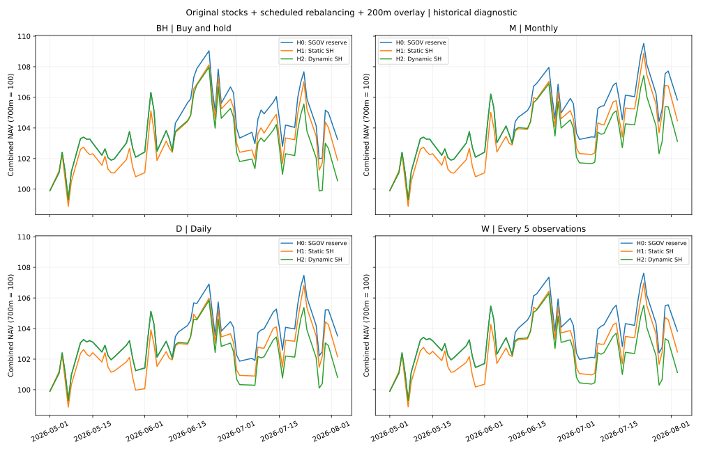
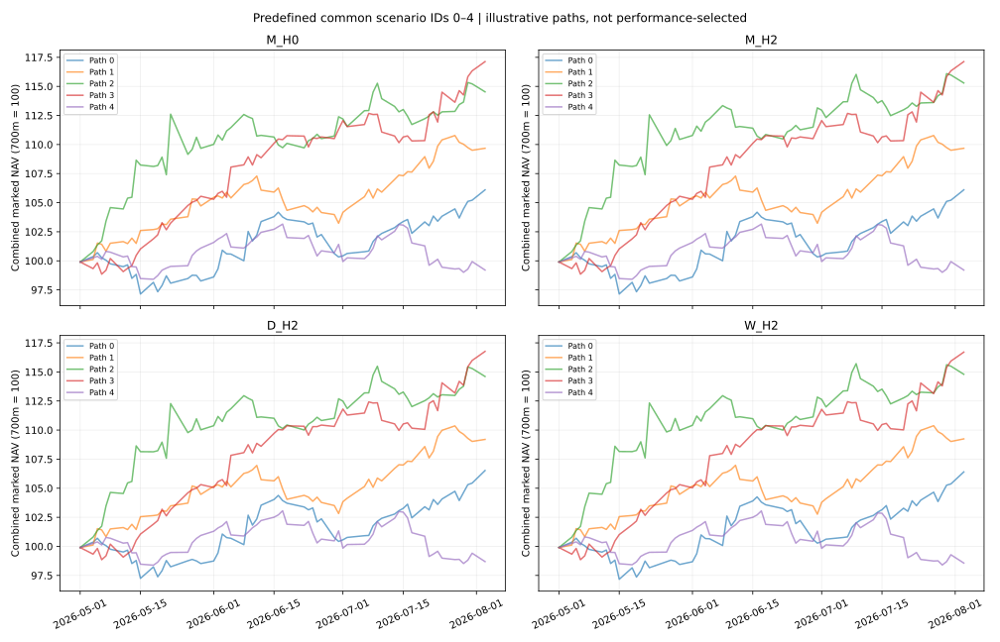

# 獨立風險驅動避險研究

原股票帳戶為 5 億美元，維持原始 12 隻股票及買入持有規則。新增 2 億美元獨立帳戶，合併起始資本 7 億美元。股票帳戶只計算一次，各避險策略共用完全相同的股票持倉及損益。這個基準選擇與再平衡頻率研究分開，不因已知績效選擇最佳頻率。

## 工具與規則

H0：額外資金保留 2% 現金緩衝，其餘買入 SGOV。H1：持續配置 SH，餘額 SGOV。H2：正常狀態持 SGOV；高風險且市場下降狀態轉入 SH；狀態解除時回到 SGOV。只在狀態改變時調整，避免把每日檢查等同每日交易。

SH 是每日 -1x S&P 500 反向 ETF；它持有期貨及交換合約，帳戶本身只買入 ETF，不交易期權。SH 不是現金等價物，跨日報酬有每日重設與複利效應。SGOV 持有 0–3 月國債，提供儲備功能。SPY 只作訊號與 beta 估計。ETF 工具只新增到獨立避險帳戶，原股票帳戶維持 stocks-only。

風險模型為可解釋的正常／壓力雙狀態模型。原目標股票報酬的 EWMA 年化風險超過訓練分布第 75 百分位，且 SPY 過去 21 段報酬累積為負時進入壓力狀態；風險低於第 50 百分位或趨勢轉正時退出。0.94 衰減、21 日趨勢及 75/50 百分位是預先宣告的探索假設，沒有經獨立樣本驗證為最佳。截止日後只更新狀態，不重新估計門檻或 beta。

SH 目標金額為預先估計並截限至 [0,1] 的股票組合對 SPY beta × 5 億美元，上限為當時避險帳戶扣除 2% 緩衝後的金額。因此可能只能部分抵銷股票市場敏感度，個股及空倉急升風險仍存在。交易以訊號日收市資料決定固定數量，下一交易日調整後收市價成交；初始建倉使用訓練末狀態。最後一日優先假設清倉。

## 歷史診斷結果

| strategy   |   net_return |   max_drawdown |   realized_volatility |   excess_return |   tracking_error |   rejected_orders |   overlay_return |   stock_net_return |   overlay_transaction_cost |   overlay_terminal_cost |   hedge_active_fraction |   simulation_percentile |
|:-----------|-------------:|---------------:|----------------------:|----------------:|-----------------:|------------------:|-----------------:|-------------------:|---------------------------:|------------------------:|------------------------:|------------------------:|
| H0         |     0.032529 |      -0.064730 |              0.207676 |        0.030235 |         0.176794 |                 0 |         0.006962 |           0.042756 |              196000.000000 |           197786.137648 |                0.000000 |               40.750000 |
| H1         |     0.018923 |      -0.063650 |              0.202953 |        0.016629 |         0.183004 |                 0 |        -0.040659 |           0.042756 |              196000.000000 |           188252.389806 |                1.000000 |               40.050000 |
| H2         |     0.005467 |      -0.074992 |              0.206829 |        0.003173 |         0.179192 |                 0 |        -0.087755 |           0.042756 |             2832744.492154 |           176324.239723 |                0.296875 |               29.890000 |

## 10,000 個共同區塊抽樣情境

股票、基準、SGOV、SH、SPY 使用完全相同歷史日期區塊，保留共同變動。每條路徑獨立過濾狀態；未來價格不得影響較早交易。所有策略使用相同 7 億美元資本，H0 是衡量避險增值的公平比較基準。

| strategy   |   mean_net_return |   median_net_return |       p05 |      p95 |   loss_frequency |   worst5_mean |   mean_max_drawdown |   mean_overlay_cost |   mean_rejected_orders |   mean_hedge_fraction |
|:-----------|------------------:|--------------------:|----------:|---------:|-----------------:|--------------:|--------------------:|--------------------:|-----------------------:|----------------------:|
| H0         |          0.056469 |            0.053528 | -0.074613 | 0.202395 |         0.260600 |     -0.103075 |           -0.058021 |       196000.000000 |               0.000000 |              0.000000 |
| H1         |          0.045717 |            0.040303 | -0.078386 | 0.188366 |         0.308400 |     -0.102159 |           -0.056166 |       196000.000000 |               0.000000 |              1.000000 |
| H2         |          0.052952 |            0.049918 | -0.081068 | 0.198633 |         0.275200 |     -0.112266 |           -0.058671 |       872880.169213 |               0.134600 |              0.120372 |

| comparison   |   mean_difference |       p05 |      p95 |   positive_frequency |
|:-------------|------------------:|----------:|---------:|---------------------:|
| H1 minus H0  |         -0.010752 | -0.040222 | 0.023116 |             0.263500 |
| H2 minus H0  |         -0.003517 | -0.020797 | 0.005217 |             0.104000 |

## 資料與限制

- 訓練：2024-04-29 至 2026-04-28；評估：2026-05-01 至 2026-08-03，63 段報酬。先凍結模型並完成模擬，才載入評估價格。
- 新工具價格為 2026-10-27 下載的 Yahoo 調整後收市價，股息及基金內費用已反映在價格報酬；不再加計股息或另扣基金費用。原股票資料來源及公司行動仍未獨立驗證。
- 原股票帳戶現金、空倉所得與抵押繼續獨立記帳；2 億美元是新增資本，沒有跨帳戶挪用或注資。股票費用沿用 10 bps 與示意 2% 年借券費。
- ETF 交易成本為示意 10 bps 實際交易額。2% 現金緩衝是研究假設；若固定訂單在價差後資金不足，拒絕整筆轉倉、保留持倉、記錄拒單，下一日以新取得的前收市資訊重試；無假設融資、追溯縮單或刪除路徑。
- 本研究是調整後價格理想化診斷，使用合成分數單位；不代表已驗證的開盤成交或券商實盤。2 億美元 SH 訂單的市場容量、價差及衝擊尚未驗證。
- 2026 評估結果早已被研究過；這是歷史診斷比較，工具與模型也是回顧性研究選擇。原計算、notebook、再平衡分支與輸出均保留。
- SH 官方：https://www.proshares.com/our-etfs/leveraged-and-inverse/sh
- SGOV 官方：https://www.ishares.com/us/products/314116/ishares-0-3-month-treasury-bond-etf
