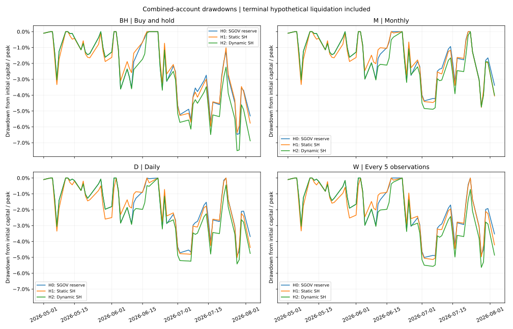
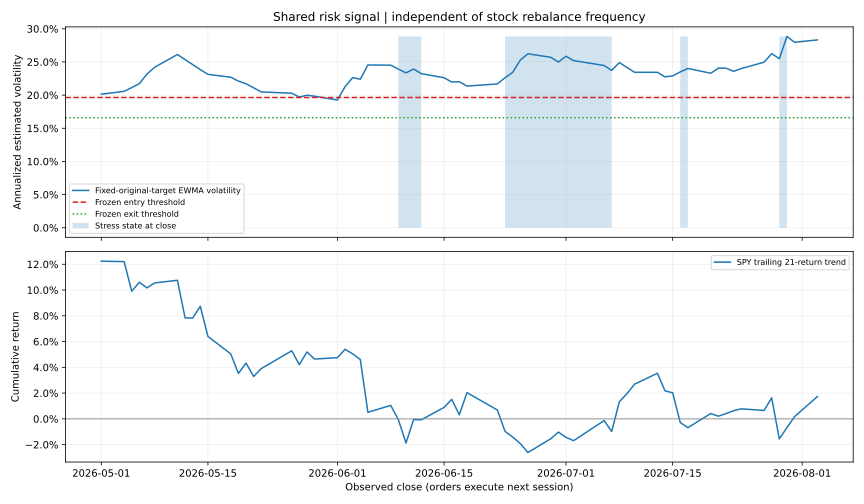

# 原有股票、再平衡與獨立避險帳戶研究

原股票帳戶為 5 億美元，保留原始 12 隻股票及凍結目標權重，結合預定再平衡規則與新增 2 億美元獨立避險帳戶。每個策略合併起始資本均為 7 億美元。先前只以買入持有股票搭配避險的初始分支定義已被本設計取代；BH 現在是保留的參考組。

## 固定股票目標與 12 個策略

| 股票規則 | 再平衡時程 | 避險策略代碼 |
| --- | --- | --- |
| BH | 初始建倉後買入持有 | BH_H0、BH_H1、BH_H2 |
| M | 每月首個觀察交易日 | M_H0、M_H1、M_H2 |
| D | 每個後續觀察交易日 | D_H0、D_H1、D_H2 |
| W | 自起點起每 5 個觀察值，並非曆週 | W_H0、W_H1、W_H2 |

各時程均排除初始建倉日及最終清倉日的例行再平衡。再平衡回到原始凍結權重，不重新選股或最佳化權重；以執行日前一收市的股票淨值及價格決定固定股數，在執行日調整後收市價成交。初始股票建倉使用首日調整後收市價，是診斷假設。

同一頻率的 H0／H1／H2 共用相同股票交易、成本與股票淨值；不同頻率則有各自的股票交易與成本。所有頻率對同一避險模式共用完全相同的 2 億美元帳戶路徑，這是刻意的控制設計：風險訊號只依固定原目標權重組合，不依再平衡後實際持倉或合併帳戶淨值。這不是各頻率即時曝險的個別最適避險；報表另量度各合併帳戶的實際波動與回撤。

## 工具與規則

H0：額外資金保留 2% 現金緩衝，其餘買入 SGOV。H1：持續配置 SH，餘額 SGOV。H2：正常狀態持 SGOV；高風險且市場下降狀態轉入 SH；狀態解除時回到 SGOV。只在狀態改變時調整，避免把每日檢查等同每日交易。

SH 是每日 -1x S&P 500 反向 ETF；它持有期貨及交換合約，帳戶本身只買入 ETF，不交易期權。SH 不是現金等價物，跨日報酬有每日重設與複利效應。SGOV 持有 0–3 月國債，提供儲備功能。SPY 只作訊號與 beta 估計。ETF 工具只新增到獨立避險帳戶，原股票帳戶維持 stocks-only。

風險模型為可解釋的正常／壓力雙狀態模型。原目標股票報酬的 EWMA 年化風險超過訓練分布第 75 百分位，且 SPY 過去 21 段報酬累積為負時進入壓力狀態；風險低於第 50 百分位或趨勢轉正時退出。0.94 衰減、21 日趨勢及 75/50 百分位是預先宣告的探索假設，沒有經獨立樣本驗證為最佳。截止日後只更新狀態，不重新估計門檻或 beta。

SH 目標金額為預先估計並截限至 [0,1] 的原目標股票組合對 SPY beta × 5 億美元，上限為當時避險帳戶扣除 2% 緩衝後的金額。因此可能只能部分抵銷股票市場敏感度，個股及空倉急升風險仍存在。避險交易以訊號日收市資料決定固定合成分數單位，下一交易日調整後收市價成交；初始避險建倉使用訓練末狀態。最後一日優先假設清倉。

## 歷史診斷結果

下表逐一列出 12 個策略。績效曲線使用 performance_nav，含末日假設清倉成本；平日為合併淨值。combined_nav 則為清倉前按市值計算的股票與避險帳戶淨值合計。

| strategy   | stock_policy   |   net_return |   max_drawdown |   realized_volatility |   excess_return |   tracking_error |   rejected_orders |   overlay_return |   stock_net_return |   stock_transaction_cost |   stock_borrow_cost |   overlay_transaction_cost |   overlay_terminal_cost |   hedge_active_fraction |   simulation_percentile |
|:-----------|:---------------|-------------:|---------------:|----------------------:|----------------:|-----------------:|------------------:|-----------------:|-------------------:|-------------------------:|--------------------:|---------------------------:|------------------------:|------------------------:|------------------------:|
| BH_H0      | BH             |     0.032529 |      -0.064730 |              0.207676 |        0.030235 |         0.176794 |                 0 |         0.006962 |           0.042756 |            500000.000000 |       526100.776027 |              196000.000000 |           197786.137648 |                0.000000 |               40.750000 |
| BH_H1      | BH             |     0.018923 |      -0.063650 |              0.202953 |        0.016629 |         0.183004 |                 0 |        -0.040659 |           0.042756 |            500000.000000 |       526100.776027 |              196000.000000 |           188252.389806 |                1.000000 |               40.050000 |
| BH_H2      | BH             |     0.005467 |      -0.074992 |              0.206829 |        0.003173 |         0.179192 |                 0 |        -0.087755 |           0.042756 |            500000.000000 |       526100.776027 |             2832744.492154 |           176324.239723 |                0.296875 |               29.890000 |
| M_H0       | M              |     0.058282 |      -0.046554 |              0.185654 |        0.055988 |         0.161220 |                 0 |         0.006962 |           0.078810 |            634752.715415 |       522616.349748 |              196000.000000 |           197786.137648 |                0.000000 |               53.240000 |
| M_H1       | M              |     0.044676 |      -0.047715 |              0.185061 |        0.042382 |         0.173077 |                 0 |        -0.040659 |           0.078810 |            634752.715415 |       522616.349748 |              196000.000000 |           188252.389806 |                1.000000 |               53.150000 |
| M_H2       | M              |     0.031220 |      -0.048909 |              0.186414 |        0.028926 |         0.165872 |                 0 |        -0.087755 |           0.078810 |            634752.715415 |       522616.349748 |             2832744.492154 |           176324.239723 |                0.296875 |               41.760000 |
| D_H0       | D              |     0.035131 |      -0.049004 |              0.185693 |        0.032837 |         0.161187 |                 0 |         0.006962 |           0.046399 |           1366193.609777 |       539566.486642 |              196000.000000 |           197786.137648 |                0.000000 |               42.540000 |
| D_H1       | D              |     0.021525 |      -0.050202 |              0.184803 |        0.019231 |         0.172862 |                 0 |        -0.040659 |           0.046399 |           1366193.609777 |       539566.486642 |              196000.000000 |           188252.389806 |                1.000000 |               42.110000 |
| D_H2       | D              |     0.008069 |      -0.054169 |              0.186350 |        0.005775 |         0.165749 |                 0 |        -0.087755 |           0.046399 |           1366193.609777 |       539566.486642 |             2832744.492154 |           176324.239723 |                0.296875 |               31.040000 |
| W_H0       | W              |     0.038260 |      -0.050054 |              0.186855 |        0.035966 |         0.161900 |                 0 |         0.006962 |           0.050779 |            898309.533407 |       535772.266816 |              196000.000000 |           197786.137648 |                0.000000 |               43.910000 |
| W_H1       | W              |     0.024654 |      -0.051364 |              0.185692 |        0.022360 |         0.173193 |                 0 |        -0.040659 |           0.050779 |            898309.533407 |       535772.266816 |              196000.000000 |           188252.389806 |                1.000000 |               43.430000 |
| W_H2       | W              |     0.011198 |      -0.056350 |              0.187581 |        0.008904 |         0.166521 |                 0 |        -0.087755 |           0.050779 |            898309.533407 |       535772.266816 |             2832744.492154 |           176324.239723 |                0.296875 |               32.470000 |

風險狀態圖標示當日收市後的狀態；對應訂單於下一觀察交易日執行，陰影不是當日已成交持倉。

## 10,000 個共同區塊抽樣情境

股票、基準、SGOV、SH、SPY 使用完全相同歷史日期區塊，保留共同變動。每條路徑獨立過濾狀態並套用四種股票時程；未來價格不得影響較早交易。所有 12 個策略使用相同 7 億美元資本。

| strategy   |   mean_net_return |   median_net_return |       p05 |      p95 |   loss_frequency |   worst5_mean |   mean_max_drawdown |   mean_overlay_cost |   mean_rejected_orders |   mean_hedge_fraction |
|:-----------|------------------:|--------------------:|----------:|---------:|-----------------:|--------------:|--------------------:|--------------------:|-----------------------:|----------------------:|
| BH_H0      |          0.056469 |            0.053528 | -0.074613 | 0.202395 |         0.260600 |     -0.103075 |           -0.058021 |       196000.000000 |               0.000000 |              0.000000 |
| BH_H1      |          0.045717 |            0.040303 | -0.078386 | 0.188366 |         0.308400 |     -0.102159 |           -0.056166 |       196000.000000 |               0.000000 |              1.000000 |
| BH_H2      |          0.052952 |            0.049918 | -0.081068 | 0.198633 |         0.275200 |     -0.112266 |           -0.058671 |       872880.169213 |               0.134600 |              0.120372 |
| D_H0       |          0.054448 |            0.051018 | -0.074689 | 0.196181 |         0.260700 |     -0.103386 |           -0.057472 |       196000.000000 |               0.000000 |              0.000000 |
| D_H1       |          0.043696 |            0.037649 | -0.079000 | 0.185277 |         0.316600 |     -0.102187 |           -0.056178 |       196000.000000 |               0.000000 |              1.000000 |
| D_H2       |          0.050931 |            0.048286 | -0.081387 | 0.193017 |         0.276100 |     -0.112190 |           -0.058172 |       872880.169213 |               0.134600 |              0.120372 |
| M_H0       |          0.054812 |            0.051358 | -0.073991 | 0.196185 |         0.260400 |     -0.103261 |           -0.057538 |       196000.000000 |               0.000000 |              0.000000 |
| M_H1       |          0.044060 |            0.038434 | -0.078344 | 0.183992 |         0.313800 |     -0.102126 |           -0.056166 |       196000.000000 |               0.000000 |              1.000000 |
| M_H2       |          0.051296 |            0.048529 | -0.080999 | 0.193643 |         0.274700 |     -0.112294 |           -0.058287 |       872880.169213 |               0.134600 |              0.120372 |
| W_H0       |          0.054529 |            0.051153 | -0.074536 | 0.195656 |         0.260700 |     -0.103611 |           -0.057455 |       196000.000000 |               0.000000 |              0.000000 |
| W_H1       |          0.043777 |            0.037999 | -0.078492 | 0.184435 |         0.313700 |     -0.102368 |           -0.056230 |       196000.000000 |               0.000000 |              1.000000 |
| W_H2       |          0.051012 |            0.048487 | -0.081694 | 0.192753 |         0.275500 |     -0.112595 |           -0.058221 |       872880.169213 |               0.134600 |              0.120372 |

配對差異使用同一路徑的淨報酬。每個頻率分別比較 H2−H0 與 H1−H0，衡量固定股票交易下的避險效果；M／D／W 的 H2 分別減去 BH_H2，衡量相同動態避險帳戶下的再平衡效果；M／D／W 的 H0 分別減去 BH_H0，衡量相同儲備帳戶下的再平衡效果。差異為報酬率差，正值頻率不等同風險全面改善，也不據此回選最佳頻率。

| comparison        |   mean_difference |       p05 |      p95 |   positive_frequency |
|:------------------|------------------:|----------:|---------:|---------------------:|
| BH_H1 minus BH_H0 |         -0.010752 | -0.040222 | 0.023116 |             0.263500 |
| BH_H2 minus BH_H0 |         -0.003517 | -0.020797 | 0.005217 |             0.104000 |
| M_H1 minus M_H0   |         -0.010752 | -0.040222 | 0.023116 |             0.263500 |
| M_H2 minus M_H0   |         -0.003517 | -0.020797 | 0.005217 |             0.104000 |
| D_H1 minus D_H0   |         -0.010752 | -0.040222 | 0.023116 |             0.263500 |
| D_H2 minus D_H0   |         -0.003517 | -0.020797 | 0.005217 |             0.104000 |
| W_H1 minus W_H0   |         -0.010752 | -0.040222 | 0.023116 |             0.263500 |
| W_H2 minus W_H0   |         -0.003517 | -0.020797 | 0.005217 |             0.104000 |
| M_H0 minus BH_H0  |         -0.001657 | -0.015373 | 0.009965 |             0.430900 |
| M_H2 minus BH_H2  |         -0.001657 | -0.015373 | 0.009965 |             0.430900 |
| D_H0 minus BH_H0  |         -0.002022 | -0.018954 | 0.012303 |             0.430200 |
| D_H2 minus BH_H2  |         -0.002022 | -0.018954 | 0.012303 |             0.430200 |
| W_H0 minus BH_H0  |         -0.001940 | -0.018915 | 0.012083 |             0.442700 |
| W_H2 minus BH_H2  |         -0.001940 | -0.018915 | 0.012083 |             0.442700 |

範例固定展示前五個情境，未依結果挑選；曲線為清倉前按市值計算的合併淨值，末日清倉成本由績效表另行反映。

## 資料與限制

- 訓練：2024-04-29 至 2026-04-28；評估：2026-05-01 至 2026-08-03，63 段報酬。先凍結模型並完成模擬，才載入評估價格。
- 新工具價格為 2026-10-27 下載的 Yahoo 調整後收市價，股息及基金內費用已反映在價格報酬；不再加計股息或另扣基金費用。原股票資料來源及公司行動仍未獨立驗證。
- 原股票帳戶現金、空倉所得與抵押繼續獨立記帳；2 億美元是新增資本，沒有跨帳戶挪用或注資。股票費用沿用 10 bps 與示意 2% 年借券費。
- ETF 交易成本為示意 10 bps 實際交易額。2% 現金緩衝是研究假設；若固定訂單在價差後資金不足，拒絕整筆轉倉、保留持倉、記錄拒單，下一日以新取得的前收市資訊重試；無假設融資、追溯縮單或刪除路徑。
- 本研究是調整後價格理想化診斷，使用合成分數單位；不代表已驗證的開盤成交或券商實盤。2 億美元 SH 訂單的市場容量、價差及衝擊尚未驗證。
- 2026 評估結果早已被研究過；這是歷史診斷比較，工具與模型也是回顧性研究選擇。原計算、notebook、再平衡分支與輸出均保留。
- SH 官方：https://www.proshares.com/our-etfs/leveraged-and-inverse/sh
- SGOV 官方：https://www.ishares.com/us/products/314116/ishares-0-3-month-treasury-bond-etf
